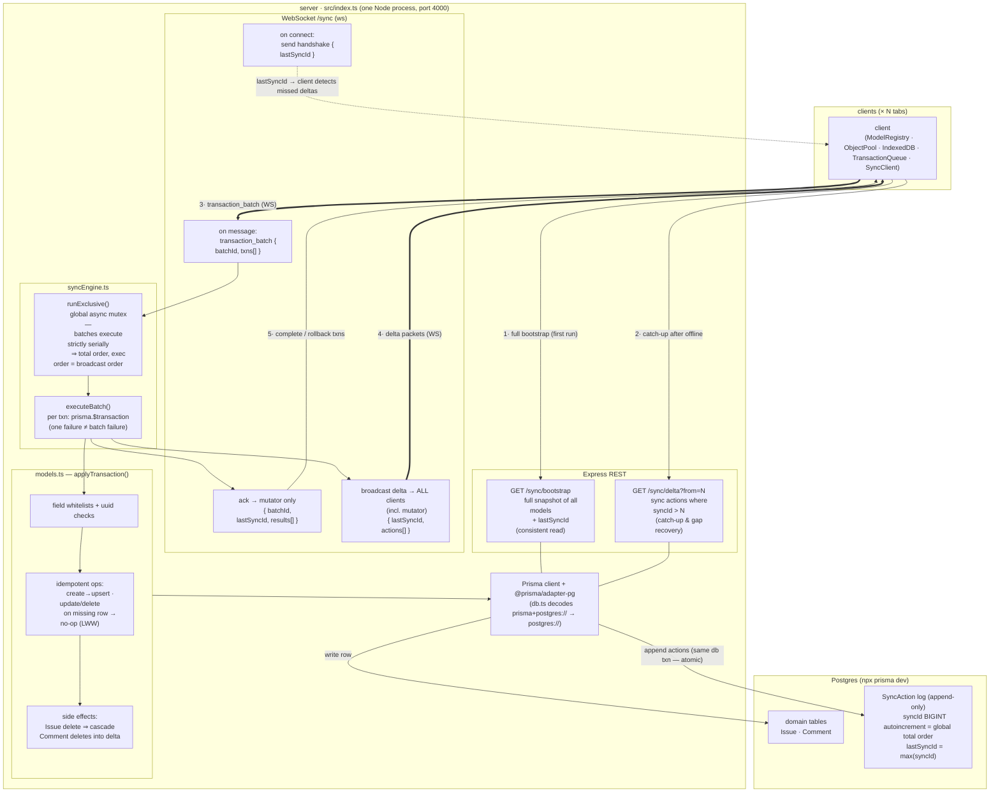

Here's the current architecture — server opened up, client collapsed to a box.

Key invariants baked into the picture:

- **One door for writes**: every mutation enters as a transaction over WS, goes through the mutex, and exits as numbered sync actions. REST is read-only.
- **Atomicity at the log**: the domain-table write and the `SyncAction` append happen in the same Postgres transaction — a `syncId` can never exist without its data change, or vice versa.
- **Total order**: the mutex + autoincrement means delta packets leave the server in exactly `syncId` order, so the client's only job is "apply in order, refetch if I see a gap".
- **The mutator learns twice**: once via the broadcast delta (data) and once via the ack (transaction completion) — matching the doc's `completedButUnsyncedTransactions` flow.

And per the earlier optimization discussion: the mutex + in-handler broadcast pair is the part you'd replace with concurrent execution + a committed-log tailer; the rest of the diagram survives that change untouched.